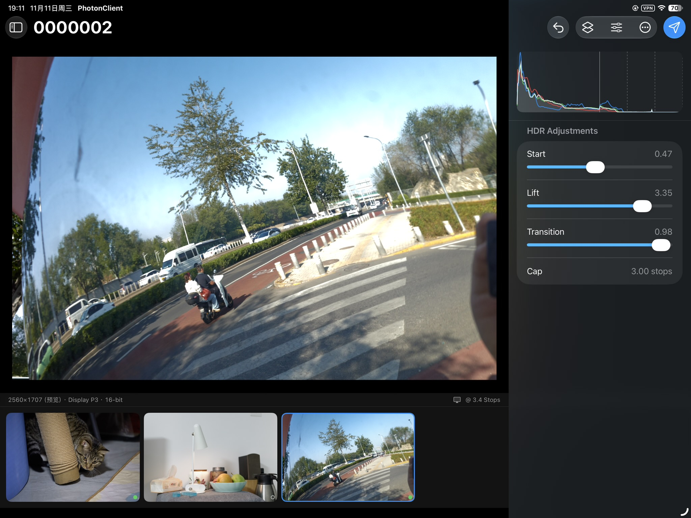

个人工具：把 Capture One 导出的 16-bit **Display P3** TIFF 做成 **gain-map HEIC（ISO 21496-1）** 的 HDR 照片。Mac 负责色彩管理渲染、编码、验证与交付；iPad 在 XDR 屏上判图，只回传一份带版本号的 recipe。

iPad 客户端效果截图：


如果无法加载，以下是其 SDR 递补图片：


HDR 最终产物：


# 快速上手

日常操作：从 P3 TIFF 生成一张可交付的 HDR HEIC。假定 CLI 已构建，iPad 应用已安装。

## 工作流程

Mac 负责渲染、编码、验证和交付；iPad 仅用于判图并回传 recipe。

```text inbox/*.tif ──serve──> iPad 判图 ──recipe──> work/<sha>/recipe.json ──deliver──> out/ ```

开始前请确认：素材是 16-bit Display P3 TIFF，已放入 `inbox/`；iPad 与 Mac 连接到同一 Wi-Fi 网络。

## 1. 启动服务

```bash .build/server/release/appctl serve --batch inbox --work work --port 8787 ```

**请查看 stderr，不要查看 stdout。** stderr 会输出 `listen` 和 `token` 两行；stdout 只有一行 JSON，是供 GUI 使用的协议，不是日志。

`listen` 中的 `<mac-lan-ip>` 是占位符。请用以下命令查询实际地址：

```bash ipconfig getifaddr en0 ```

判图期间，请勿停止此进程。

## 2. 连接 iPad

Host 填写上方查询到的 IP，Port 填写 `8787`，Token 填写 stderr 中显示的字符串，然后点击 Connect。

## 3. 判图

选择图片 → 选择 Cap并调整三个滑条（Start HDR / Highlight lift / Transition） → 点击发送按钮。

点击发送按钮后，recipe 会保存在 Mac 的 `work/<sha>/recipe.json` 中。

## 4. 交付

```bash .build/server/release/appctl deliver --batch inbox --out out/ ```

每个有 recipe 的素材都会生成一组文件；没有 recipe 的素材会被跳过。只有请求的每个 profile 均通过全部 8 项检查，文件才会写入磁盘；只要有任意一项检查失败，就不会写入任何文件，退出码为 1。

## 产物在哪

| 路径 | 内容 |
|---|---|
| `out/{stem}-hdr-{profile}.heic` | 交付的 gain-map HEIC，默认 `10-half-rgb` |
| `out/{stem}-sdr.heic` | 移除 gain map 后的 SDR 回退文件 |
| `out/{stem}.recipe.json` | 实际使用的 recipe |
| `out/{stem}.report.json` | 验证报告 |
| `work/<sha>/` | 每个素材的中间文件与 recipe |
| `work/<sha>/rejected/<renderKey12>/` | 失败证据：暂存产物和 report |

## 出问题怎么办

| 现象 | 处理方法 |
|---|---|
| `sourceHashMismatch` | 源文件已重新导出，旧 recipe 失效。请重新判图 |
| `unsupportedSource` | 源文件不是 Display P3。请返回 Capture One，以 P3 重新导出 |
| `hdrTooDim` | 峰值低于 1.05。请提高 Highlight lift 或 Cap，然后重新点击 Submit |
| `unauthorized` | token 不正确。请返回连接页重新填写 |
| iPad 无法连接 | 请确认设备处于同一网段、`serve` 仍在运行，且端口未被占用 |

## 想深入了解

- 命令与选项 → [reference/cli.md](reference/cli.md)
- 交付契约、report、检查 → [reference/deliver.md](reference/deliver.md)
- recipe 字段与数学 → [reference/recipe.md](reference/recipe.md)
- 判图硬件与条件 → [reference/hardware.md](reference/hardware.md)
- 容器验证 → [reference/verification.md](reference/verification.md)
